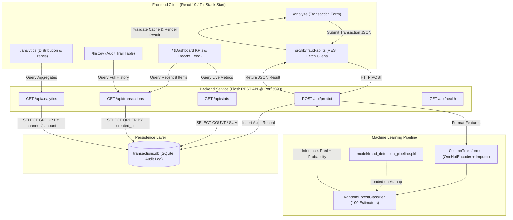

# FraudLens — AI-Based Financial Fraud Detection Platform

FraudLens is an end-to-end, full-stack financial fraud detection and analytics platform. It combines a machine learning inference pipeline powered by Scikit-learn with a Python Flask REST API, an SQLite audit log, and a modern React 19 frontend built on TanStack Start and Tailwind CSS.

The platform simulates how fintech companies, payment gateways, and banking security operations centers (SOCs) evaluate financial transactions in real time, score fraud probabilities, assign risk levels, and audit historical patterns.

---

## 1. Objectives & Key Capabilities

- **Real-Time Fraud Evaluation**: Evaluates incoming financial transactions in milliseconds using an ensemble machine learning pipeline (`RandomForestClassifier`).
- **Explainable Risk Scoring**: Generates a fraud probability percentage ($0.0\% - 100.0\%$), a confidence score, and a calibrated Risk Level (`Low`, `Medium`, `High`).
- **Support for Modern Payment Rails**: Accommodates digital payment channels including **UPI**, **Card**, **Bank Transfer**, **Digital Wallet**, and **ATM**.
- **Audit Logging & Persistence**: Automatically logs every transaction evaluation into a persistent SQLite database with audit timestamps in India Standard Time (`Asia/Kolkata`, UTC+05:30).
- **Interactive Security Operations Dashboard**: Visualizes live KPIs (Total Analyzed, Legitimate Count, Fraud Flagged, Fraud Rate) with real-time class distribution and volume charts.
- **Audit Log & Analytics**: Offers a full searchable transaction history log and aggregated visual distributions by channel, amount band, and fraud volume timeline.
- **Graceful Failure & Transparent Fallback**: Distinguishes real live model predictions from demonstration data, providing clean loading, empty, and connection-retry states.

---

## 2. Technology Stack

### Backend & Machine Learning
- **Python**: 3.10+ (verified and tested on Python 3.14.2)
- **Framework**: Flask 3.x with Flask-CORS for cross-origin communication
- **Machine Learning**: Scikit-learn (Pipeline, `RandomForestClassifier`, `ColumnTransformer`, `OneHotEncoder`, `SimpleImputer`)
- **Data Manipulation**: Pandas, NumPy
- **Model Serialization**: Joblib
- **Database**: SQLite3 (embedded file-based audit log)
- **Testing**: Python standard library `unittest`

### Frontend Application
- **Runtime & Package Manager**: Node.js 20+ (tested on Node.js v24.21.0) / npm (tested on npm 11.19.0)
- **Core Framework**: React 19 with TypeScript
- **Full-Stack Routing & SSR**: TanStack Start (TanStack Router + Nitro server engine)
- **State & Server Cache**: TanStack Query v5 (React Query)
- **Styling**: Tailwind CSS v4, Lucide React icons
- **Data Visualization**: Recharts (Area charts, Bar charts, Pie charts, Line charts)
- **Notifications**: Sonner toast system
- **Build Tool**: Vite 8

---

## 3. Architecture & Data Flow



---

## 4. Project Directory Structure

```text
AI-BASED FINANCIAL FRAUD DETECTION/
├── backend/
│   ├── dataset/
│   │   └── fraudTrain.csv            # Kaggle credit card fraud simulation training data
│   ├── model/
│   │   └── fraud_detection_pipeline.pkl # Pre-trained Scikit-learn Pipeline
│   ├── app.py                         # Flask REST API server & inference endpoints
│   ├── database.py                    # SQLite initialization, schema, queries & IST handling
│   ├── train_model.py                 # Pipeline training, validation & serialization script
│   ├── evaluate_model.py              # Comparative offline evaluation script (dual benchmarks)
│   ├── evaluate_group_generalization.py # Isolated research evaluator for unseen-cardholder generalization
│   ├── evaluation_report.json         # Serialized metrics, confusion matrices & disclosures
│   ├── test_api.py                    # 19-test automated API and benchmark test suite
│   ├── transactions.db               # SQLite audit database (auto-generated at runtime)
│   └── requirements.txt               # Backend Python dependencies
├── frontend/
│   └── lovable_project/
│       ├── public/                    # Static assets & web manifests
│       ├── src/
│       │   ├── components/            # UI components (cards, tables, badges, dialogs)
│       │   ├── lib/
│       │   │   ├── api-queries.ts     # TanStack Query options & cache keys
│       │   │   ├── demo-data.ts       # Synthetic demonstration fallback & formatters
│       │   │   ├── fraud-api.ts       # Typed API client, validation, error mapping
│       │   │   └── utils.ts           # CSS class merging utility
│       │   ├── routes/
│       │   │   ├── index.tsx          # Dashboard page (/)
│       │   │   ├── analyze.tsx        # Transaction analysis form page (/analyze)
│       │   │   ├── history.tsx        # Audit log history table page (/history)
│       │   │   ├── analytics.tsx      # Charts & visual distribution page (/analytics)
│       │   │   ├── about.tsx          # Methodology & system documentation page (/about)
│       │   │   └── __root.tsx         # Root layout, navigation sidebar, toast provider
│       │   ├── router.tsx             # TanStack Router configuration
│       │   ├── styles.css             # Tailwind CSS tokens & styling
│       │   └── server.ts              # Nitro SSR server entry point
│       ├── package.json               # Frontend dependencies and npm scripts
│       ├── tsconfig.json              # TypeScript compilation config
│       └── vite.config.ts             # Vite configuration with TanStack Start plugin
├── .gitignore                         # Git exclusion rules (.env, *.db, node_modules)
└── README.md                          # Project documentation (this file)
```

---

## 5. Prerequisites & Windows Setup

### Prerequisites
- **Operating System**: Windows 10 or Windows 11 (64-bit)
- **Python**: Version 3.10 to 3.14 installed with `Add Python to PATH` checked
- **Node.js**: Version 20.x or higher
- **npm**: Version 10.x or higher

---

### Step 1: Set Up and Start the Flask Backend

Open **Terminal 1** (PowerShell or Command Prompt):

1. Navigate to the `backend` directory:
   ```powershell
   cd "backend"
   ```

2. *(Optional but Recommended)* Create and activate a Python virtual environment:
   ```powershell
   python -m venv venv

   # On Windows PowerShell (if script execution is restricted, temporarily bypass for current shell):
   Set-ExecutionPolicy -Scope Process -ExecutionPolicy Bypass
   .\venv\Scripts\Activate.ps1

   # Or in Command Prompt (cmd.exe):
   .\venv\Scripts\activate.bat
   ```

3. Install the required Python packages:
   ```powershell
   pip install -r requirements.txt
   ```

4. Verify the pre-trained model file exists at `backend/model/fraud_detection_pipeline.pkl`. If you wish to retrain the model from the training dataset:
   ```powershell
   python train_model.py
   ```

5. Run the automated backend test suite:
   ```powershell
   python -m unittest test_api.py -v
   ```
   *(All 19 tests should pass with `OK`).*

6. Start the Flask API server:
   ```powershell
   python app.py
   ```
   The backend will start on **`http://127.0.0.1:5000`**. You should see:
   ```text
   Fraud detection model loaded successfully from: ...\backend\model\fraud_detection_pipeline.pkl
   Model classes: [0, 1] (Fraud index: 1, Legit index: 0)
   REST API URL: http://127.0.0.1:5000
   Health check: http://127.0.0.1:5000/api/health
   ```

---

### Step 2: Set Up and Start the Frontend Application

Open **Terminal 2** (keep Terminal 1 running):

1. Navigate to the frontend directory:
   ```powershell
   cd "frontend\lovable_project"
   ```

2. Install the frontend dependencies:
   ```powershell
   npm install
   ```

3. Configure the environment URL (Optional):
   - By default, `src/lib/fraud-api.ts` connects directly to `http://127.0.0.1:5000`.
   - If you need to specify a custom host or port, copy the example environment file:
     ```powershell
     copy .env.example .env.local
     ```
   - Inside `.env.local`:
     ```env
     VITE_FLASK_API_URL=http://localhost:5000
     ```
   - **Security note**: The `.gitignore` file strictly excludes `.env`, `.env.local`, `.env.*.local`, and database files. No private keys, secrets, or credentials are required or stored.

4. Run frontend code linting:
   ```powershell
   npm run lint
   ```

5. Start the development server:
   ```powershell
   npm run dev
   ```

6. Check the terminal output for the local server URL (the TanStack Start Vite server binds to **`http://localhost:8080`** by default, or `8081` if 8080 is busy):
   ```text
   ➜  Local:   http://localhost:8080/
   ```
   Open this URL in your web browser.

---

## 6. Build and Verification Commands Reference

| Task | Working Directory | Command |
|---|---|---|
| Run Backend API | `backend/` | `python app.py` |
| Run Backend Unit Tests | `backend/` | `python -m unittest test_api.py -v` |
| Run Production Model Evaluation Benchmark | `backend/` | `python evaluate_model.py` |
| Run Unseen-Cardholder Generalization Benchmark | `backend/` | `python evaluate_group_generalization.py` |
| Train / Retrain ML Model | `backend/` | `python train_model.py` |
| Install Frontend Dependencies | `frontend/lovable_project/` | `npm install` |
| Run Frontend Dev Server | `frontend/lovable_project/` | `npm run dev` |
| Run Frontend ESLint | `frontend/lovable_project/` | `npm run lint` |
| Run Frontend Production Build | `frontend/lovable_project/` | `npm run build` |
| Preview Production Build | `frontend/lovable_project/` | `npm run preview` |

> [!NOTE]
> `python evaluate_group_generalization.py` trains an isolated research pipeline in memory using `StratifiedGroupKFold` on credit card numbers (`cc_num`) to benchmark zero-shot generalization across 197 completely unseen cardholders. Fitting on ~1M transactions takes approximately 60–90 seconds and requires additional memory. It is strictly an offline research benchmark and **does not** retrain, overwrite, or replace the live production model (`fraud_detection_pipeline.pkl`).

---

## 7. REST API Documentation

### 1. Health Status
- **Method**: `GET`
- **Route**: `/api/health`
- **Description**: Verifies API availability, model status, and database connectivity.
- **Response `200 OK`**:
  ```json
  {
    "database": "connected",
    "model_loaded": true,
    "model_name": "RandomForestClassifier Pipeline",
    "status": "healthy",
    "total_records": 24
  }
  ```

---

### 2. Predict & Log Transaction
- **Method**: `POST`
- **Route**: `/api/predict`
- **Headers**: `Content-Type: application/json`
- **Request Body**:
  ```json
  {
    "transactionId": "TXN-100245",
    "amount": 2500.0,
    "channel": "UPI",
    "merchantCategory": "Groceries",
    "country": "India"
  }
  ```
- **Validation Rules**:
  - `amount`: Required, must be a numeric value $> 0$ and $\le 100,000,000$.
  - `channel`: Supported channels include `UPI`, `Card`, `Transfer`, `Wallet`, `ATM`.
  - `merchantCategory`: Mapped to internal dataset categories (`groceries` $\to$ `grocery_pos`, `restaurants` $\to$ `food_dining`, etc.).
- **Response `200 OK`**:
  ```json
  {
    "amount": 2500.0,
    "channel": "UPI",
    "confidence": 0.98,
    "country": "India",
    "createdAt": "2026-10-26T15:25:50.013599+05:30",
    "created_at": "2026-10-26T15:25:50.013599+05:30",
    "fraudProbability": 0.02,
    "fraud_probability": 0.02,
    "hasTransactionTime": false,
    "has_transaction_time": false,
    "hoursSincePrevTxn": 0.0,
    "hours_since_prev_txn": 0.0,
    "isFraud": 0,
    "is_fraud": 0,
    "label": "Legitimate",
    "merchantCategory": "Groceries",
    "merchant_category": "Groceries",
    "prediction": "Legitimate",
    "riskLevel": "Low",
    "risk_level": "Low",
    "timestamp": "2026-10-26T15:25:50.013599+05:30",
    "transactionId": "TXN-100245",
    "transactionTime": null,
    "transaction_id": "TXN-100245",
    "transaction_time": null
  }
  ```

---

### 3. Transaction History
- **Method**: `GET`
- **Route**: `/api/transactions?limit=100`
- **Description**: Returns persisted transactions ordered newest first (`created_at DESC, id DESC`).
- **Response `200 OK`**:
  ```json
  {
    "total": 24,
    "transactions": [
      {
        "transactionId": "TXN-100245",
        "amount": 2500.0,
        "channel": "UPI",
        "merchantCategory": "Groceries",
        "label": "Legitimate",
        "prediction": "Legitimate",
        "fraudProbability": 0.02,
        "riskLevel": "Low",
        "hasTransactionTime": false,
        "timestamp": "2026-10-26T15:25:50.013599+05:30",
        "createdAt": "2026-10-26T15:25:50.013599+05:30"
      }
    ]
  }
  ```

---

### 4. Summary Statistics
- **Method**: `GET`
- **Route**: `/api/stats`
- **Description**: Returns aggregate audit metrics with zero-division protection (includes camelCase standard keys and snake_case aliases).
- **Response `200 OK`**:
  ```json
  {
    "totalTransactions": 24,
    "legitimateTransactions": 16,
    "fraudulentTransactions": 8,
    "fraudRate": 33.33,
    "total_transactions": 24,
    "legitimate_count": 16,
    "fraud_count": 8,
    "fraud_rate": 33.33
  }
  ```

---

### 5. Aggregated Visual Analytics
- **Method**: `GET`
- **Route**: `/api/analytics`
- **Description**: Computes channel counts, label ratios, amount distribution bands, and daily trend volume.
- **Response `200 OK`**:
  ```json
  {
    "channelBreakdown": [
      { "channel": "UPI", "legitimate": 10, "flagged": 4 },
      { "channel": "Card", "legitimate": 4, "flagged": 4 },
      { "channel": "Transfer", "legitimate": 1, "flagged": 0 },
      { "channel": "Wallet", "legitimate": 0, "flagged": 0 },
      { "channel": "ATM", "legitimate": 0, "flagged": 0 }
    ],
    "labelDistribution": [
      { "name": "Legitimate", "value": 16 },
      { "name": "Fraudulent", "value": 8 }
    ],
    "amountBands": [
      { "band": "0–1k", "count": 19 },
      { "band": "1k–3k", "count": 2 },
      { "band": "3k–6k", "count": 2 },
      { "band": "6k+", "count": 1 }
    ],
    "transactionTrend": [
      { "day": "2026-10-26", "transactions": 3, "flagged": 1 }
    ],
    "totalTransactions": 24,
    "legitimateTransactions": 16,
    "fraudulentTransactions": 8
  }
  ```

---

## 8. Machine Learning Pipeline & Scoring Methodology

### Training Data & Preprocessing
The pipeline was trained on a large-scale simulated financial fraud dataset (`fraudTrain.csv`), modeling behavioral patterns across merchant categories, transaction amounts, demographics, and temporal variations.

1. **Feature Engineering**:
   - `transaction_hour`: Hour of transaction ($0 - 23$)
   - `transaction_day`: Day of month ($1 - 31$)
   - `transaction_month`: Calendar month ($1 - 12$)
2. **ColumnTransformer Architecture**:
   - **Categorical Pipeline**: `category`, `gender` $\to$ `SimpleImputer(strategy='most_frequent')` $\to$ `OneHotEncoder(handle_unknown='ignore')`
   - **Numerical Pipeline**: `amt`, `lat`, `long`, `city_pop`, `merch_lat`, `merch_long`, `transaction_hour`, `transaction_day`, `transaction_month` $\to$ `SimpleImputer(strategy='median')`
3. **Classifier**:
   - `RandomForestClassifier(n_estimators=100, class_weight='balanced_subsample', random_state=42)`

### Risk Level Calibration
The model outputs raw class probabilities via `predict_proba`. Fraud probability ($P_{\text{fraud}}$) is mapped into three risk tiers:

| Fraud Probability Range | Risk Level | Badge Color | SOC Recommended Action |
|---|---|---|---|
| $0.0\% \le P_{\text{fraud}} < 30.0\%$ | **Low** | Emerald Green | Auto-approve transaction |
| $30.0\% \le P_{\text{fraud}} < 70.0\%$ | **Medium** | Amber Yellow | Flag for secondary verification / OTP |
| $70.0\% \le P_{\text{fraud}} \le 100.0\%$ | **High** | Destructive Red | Immediate block & alert security analyst |

---

## 9. Model Evaluation and Limitations

FraudLens implements offline model evaluation suites that measure fraud detection performance across both the production model and isolated research benchmarks.

To maintain academic rigor and transparency, the platform establishes two separate evaluation frameworks:
1. **Production Model Benchmark (Random Held-Out Split)**: Evaluates the pre-trained saved pipeline ([`backend/model/fraud_detection_pipeline.pkl`](backend/model/fraud_detection_pipeline.pkl)) against held-out test data from the original training split without retraining.
2. **Unseen-Cardholder Generalization Benchmark (Stratified Group-Held-Out Split)**: Evaluates an isolated research pipeline trained on disjoint cardholders to benchmark generalization across previously unseen accounts.

> [!IMPORTANT]
> The random-split and group-held-out benchmarks measure different operational conditions and are **not directly interchangeable**:
> - The **random-split benchmark** measures detection accuracy when transactions come from known cardholders whose historical profiles exist in the training set.
> - The **group-held-out benchmark** measures zero-shot generalization when transactions originate from completely novel cardholders with zero prior history in training.

---

### A. Production Model Benchmark (Random Held-Out Split, N = 259,335)

Evaluated via [`backend/evaluate_model.py`](backend/evaluate_model.py) on the exact same 259,335-row held-out partition of `fraudTrain.csv` (1,501 fraud cases, 257,834 legitimate cases, 0.5788% fraud prevalence):
- **Full-Feature Benchmark (Idealized Baseline)**: Evaluates the model when all 11 original dataset features (including demographic coordinates and population) are available.
- **UI-Imputed Benchmark (Realistic Live Inference)**: Evaluates the exact same held-out rows after replacing the six features not collected in the Analyze form (`gender`, `lat`, `long`, `city_pop`, `merch_lat`, `merch_long`) with `numpy.nan`, exactly matching live inference in [`backend/app.py`](backend/app.py) where fitted `SimpleImputer` steps supply learned medians and modes.

| Metric | Full-feature benchmark | UI-imputed benchmark |
|---|---:|---:|
| Precision | 93.77% | 87.91% |
| Recall | 73.15% | 70.75% |
| F1-score | 0.8219 | 0.7841 |
| Accuracy | 99.82% | 99.77% |
| PR-AUC / Average Precision | 0.8888 | 0.8395 |
| ROC-AUC | 0.9907 | 0.9803 |
| True positives | 1,098 | 1,062 |
| False positives | 73 | 146 |
| False negatives | 403 | 439 |
| True negatives | 257,761 | 257,688 |

*Decision threshold: 0.50. Evaluated on the 20% stratified held-out test split of `fraudTrain.csv` ($N = 259,335$). Report serialized at [`backend/evaluation_report.json`](backend/evaluation_report.json).*

---

### B. Unseen-Cardholder Generalization Benchmark (Stratified Group Split, N = 259,242)

Evaluated via [`backend/evaluate_group_generalization.py`](backend/evaluate_group_generalization.py) to assess how effectively the Random Forest architecture generalizes to accounts that the model has never encountered before.

**Methodology & Isolation:**
- **Partitioning Strategy**: Partitioned with `StratifiedGroupKFold(n_splits=5, shuffle=True, random_state=42)` grouped by card number (`cc_num`). Selected **Fold 1** allocates **786 cardholders** ($1,037,433$ rows) to training and holds out **197 cardholders** ($259,242$ rows: $1,501$ fraud, $257,741$ legitimate, $0.5790\%$ fraud prevalence) with **zero cardholder overlap** ($\text{overlap} = 0$).
- **Research Pipeline Isolation**: Trains a fresh research pipeline strictly in memory with the identical architecture (`ColumnTransformer` + `RandomForestClassifier(n_estimators=100, class_weight='balanced_subsample')`). It **does not** retrain, modify, or replace the live production model (`fraud_detection_pipeline.pkl`).
- **Feature Configurations**: Evaluated both with all 11 features and under UI-imputed conditions where the six uncollected features (`gender`, `lat`, `long`, `city_pop`, `merch_lat`, `merch_long`) are masked with `numpy.nan`.

| Metric | Unseen-cardholder full-feature | Unseen-cardholder UI-imputed |
|---|---:|---:|
| Precision | 92.85% | 89.96% |
| Recall | 68.35% | 71.02% |
| F1-score | 0.7874 | 0.7937 |
| Accuracy | 99.79% | 99.79% |
| PR-AUC / Average Precision | 0.8552 | 0.8386 |
| ROC-AUC | 0.9793 | 0.9786 |
| True positives | 1,026 | 1,066 |
| False positives | 79 | 119 |
| False negatives | 475 | 435 |
| True negatives | 257,662 | 257,622 |

*Decision threshold: 0.50. Evaluated on Fold 1 held-out cardholders of `fraudTrain.csv` ($N = 259,242$, 197 disjoint cardholders). Report serialized under `unseen_cardholder_benchmark` in [`backend/evaluation_report.json`](backend/evaluation_report.json).*

---

### Key Evaluation Findings

1. **Feature Imputation Robustness**: Under UI inference conditions where geographic coordinates and demographics are missing, both benchmarks demonstrate high resilience. The classifier preserves solid discriminative ability ($F_1 = 0.7841$ on familiar cardholders; $F_1 = 0.7937$ on unseen cardholders) because transaction amount (`amt`, 59.0% feature weight), merchant category (`category`, 13.9% weight), and hour of day (`transaction_hour`, 15.8% weight) govern over 88% of total model decisions.
2. **Account Generalization Capability**: When transitioning from familiar cardholders to completely unseen cardholders under UI inference, PR-AUC drops marginally from **0.8395** to **0.8386** ($-0.0009$), precision remains strong at **89.96%**, and recall reaches **71.02%**, proving that the model learns generic fraudulent spending behaviors rather than overfitting to specific cardholder identities.

---

### Critical Methodology Limitations

1. **Synthetic/Offline Dataset**: All evaluations are conducted on offline synthetic transaction datasets (`fraudTrain.csv`), not verified live production bank, credit card, or UPI clearing networks.
2. **Random vs. Group Partitioning**: In the production model's random test split, all 969 unique cardholders appear in both train and test partitions. In contrast, the group-held-out research evaluation guarantees zero cardholder overlap (197 disjoint cardholders).
3. **Generalization Horizons**: While customer generalization to unseen cardholders has been empirically confirmed, **chronological out-of-time (OOT) generalization** on future transaction dates remains unbenchmarked.
4. **Simulation vs. Live Guarantee**: The UI-imputed benchmarks simulate the exact missing-value conditions of the web Analyze form via `numpy.nan` imputation, but do not guarantee live operational efficacy under changing fraud dynamics.
5. **Metadata Fields**: Digital channel (`channel`) and `country` are contextual audit metadata and are not active inputs in the underlying card-based Random Forest classifier.

---

## 10. Timestamp & Timezone Conventions

- **Indian Context**: The application uses **India Standard Time (`Asia/Kolkata`, UTC+05:30)** consistently.
- **Distinction of Timestamps**:
  - **Transaction Time**: The historical instant when payment occurred (if present in imported dataset records).
  - **Recorded / Analysis Time**: The system timestamp when an analyst manually submits a transaction for real-time scoring.
  - The UI explicitly renders `RECORDED / ANALYSIS TIME` for manual transactions, avoiding false claims of knowing actual payment execution time when not provided.

---

## 11. Database Schema (`transactions.db`)

The SQLite audit database creates the following table schema automatically upon first startup:

```sql
CREATE TABLE IF NOT EXISTS transactions (
    id INTEGER PRIMARY KEY AUTOINCREMENT,
    transaction_id TEXT UNIQUE NOT NULL,
    amount REAL NOT NULL,
    channel TEXT NOT NULL,
    merchant_category TEXT NOT NULL,
    country TEXT NOT NULL,
    hours_since_prev_txn REAL DEFAULT 0.0,
    prediction TEXT NOT NULL,
    label TEXT NOT NULL,
    is_fraud INTEGER NOT NULL,
    fraud_probability REAL NOT NULL,
    confidence REAL NOT NULL,
    risk_level TEXT NOT NULL,
    timestamp TEXT NOT NULL,
    created_at TEXT NOT NULL
);
CREATE INDEX IF NOT EXISTS idx_tx_created ON transactions (created_at DESC);
CREATE INDEX IF NOT EXISTS idx_tx_fraud ON transactions (is_fraud);
```

---

## 12. Testing & Verification Summary

The project includes continuous verification suites:

- **Backend Test Suite (`test_api.py`)**: 19 automated test cases covering:
  - API health status and model availability
  - Input validation (missing body, empty amount, negative values, non-numeric strings)
  - Normalization of legitimate and fraudulent inference payloads
  - Pagination and sorting of transaction history
  - Zero-division safety in statistical calculations
  - Complete chart aggregation contract tests for analytics
  - Strict preservation of ISO 8601 timestamps and IST timezone fallbacks
  - Missing feature imputation handling via `SimpleImputer` learned statistics
  - Explicit coordinate and demographic pass-through verification
  - Programmatic verification of the production model dual-benchmark evaluation consistency (test 18)
  - Programmatic verification of the unseen-cardholder benchmark report, disjoint account splitting, and group confusion matrix consistency (test 19)
- **Offline Model Evaluator (`evaluate_model.py`)**:
  - Reproducible offline benchmark script measuring both full-feature and UI-imputed performance on the production model's random held-out partition ($N = 259,335$).
  - Exports serialized metrics, confusion matrices, and risk threshold analyses to `backend/evaluation_report.json`.
- **Unseen-Cardholder Generalization Evaluator (`evaluate_group_generalization.py`)**:
  - Reproducible group-held-out research evaluator executing `StratifiedGroupKFold` partitioning and dual benchmarking across 197 unseen accounts ($N = 259,242$).
  - Appends structured benchmark results under `unseen_cardholder_benchmark` in `backend/evaluation_report.json` without modifying production artifacts.
- **Frontend Code Quality**:
  - `npm run lint`: ESLint with TypeScript rules (0 errors)
  - `npm run build`: Production bundle compilation (Client, SSR, and Nitro server workers)
- **Live Integration Check**: Verified end-to-end submitting real transactions through the API, verifying database persistence, and ensuring live dashboard updates without page reloads.

---

## 13. Limitations & Academic Prototype Disclosure

1. **Simulation Environment**: This platform is an **academic and research prototype**. It does not integrate with live clearing networks (e.g., NPCI UPI Switch, Visa/Mastercard networks, Core Banking Systems, or SWIFT).
2. **Feature Imputation**: Demographic and geographic features not gathered in the UI use the fitted pipeline's learned training medians and modes (`SimpleImputer`), which serves as a privacy-preserving baseline.
3. **Model Retraining**: In a production enterprise setting, models are retrained periodically on streaming event queues (e.g., Kafka / Flink). FraudLens relies on the pre-trained offline pipeline for inference.
4. **Demonstration Mode**: If the Flask backend service is offline, the frontend provides an optional synthetic demonstration mode to allow visual exploration of UI widgets without crashing.
